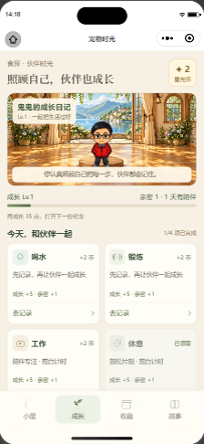
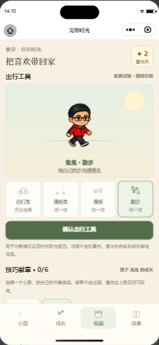
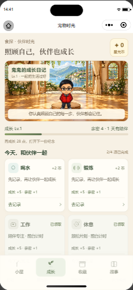

# 成长与周报流程阶段验收

按用户确认的顺序，先恢复原生导航和截图，再验收四项行动、书架，随后检查出行与照片角色。本轮没有修改业务代码；下列结论来自真实账号的运行操作，未模拟记录或修改时钟。

## 本轮通过

| 检查 | 实际结果 |
| --- | --- |
| 进入书架并取书 | 原生导航成功，点击已有书进入周报；返回书架检测到两本书，无取回错误 |
| 周报正文 | 检测到故事场景，未出现加载骨架或报告错误，取得下方真实截图 |
| 四项成长入口 | 喝水、锻炼、工作、休息入口均存在、可触摸；已完成休息入口随后正确禁用 |
| 工作计时 | 整卡标题可打开计时；开始、暂停、切到小屋、返回成长、明确继续和结束操作通过 |
| 未完成不发奖 | 工作计时结束后钱包仍 0 币、0 条回执，无残留计时 |
| 休息完成结算 | 使用真实 1 分钟前台计时，等待完成；钱包从 0 到 2 币，回执从 0 到 1，计时清除 |
| 防重复领取 | 再次触摸休息按钮，按钮禁用，余额保持 2 币、回执保持 1 条 |
| 卡片尺寸与状态 | 四卡实际宽 182px、高约 161px；最小高度 47px，禁用卡背景与文字颜色明显区别 |
| 成长导航 | 小屋、成长、收藏、故事入口触摸与返回成长通过；初轮仅预览入口未改变钱包 |

此图是当前周报阅读器的原生截图，不是书架截图，也不是设计渲染图。

后续重开项目并重新启用自动化成功，取得并逐张查看以下截图：

| 实际书架 | 完成休息后的成长页 | 出行预览与收藏 |
| --- | --- | --- |
|  |  |  |

当前角色的自行车、滑板车、滑板和散步预览切换通过，未点击确认或扣币。滑板样式显示 1.5s 播放且为 running，但三次查询得到相同 transform；此信息只能证明播放配置存在，不能作为自然连续动作已通过的证据。

## 未完成与限制

- 当前饮水、运动显示“去记录”，本轮没有代填健康记录或制造领奖依据。后续实际页面栈确认两种入口均到达对应记录页；返回后仍报告记录页，返回流程未通过。`entry-transport.json` 保留失败结果，`routes-screens.json` 中该两步的 ok 只表示调用完成，returned 值不满足返回成长页条件，不能算完整链路通过。
- 书架、成长和收藏多次截图曾返回 `fail to capture screenshot`；后续重开取得上方新截图。截图仍有间歇性失败，不能宣布工具完全稳定或全页面、全角色视觉验收完成。
- 仅重开当前食探项目，CLI open 与后续 auto 重新启用均成功；先前准备阶段阻塞已解除。未退出整个 IDE、清理登录、修改用户私有配置或重启后端。
- 当前账号真实增加的 2 星光币来自正常休息计时结算。没有清除这次合法回执或回滚钱包，避免影响已保存的账号进度。
- 出行预览后续切换通过，但未确认六角色手、车把、臀部、车座和脚踏的视觉接触。自行车仍为滑行，不是连续踩踏；滑板车仍是站姿重心变化。本轮没有将它们改成未经验证的新动作。
- 真实照片生成待用户指定已有照片路径。未使用历史截图冒充照片，未调用收费生成接口，也没有替换当前宠物。

## 专项回归

动作、工具适配、素材边距与浮窗检查：4 套、40 项 Jest 通过，耗时 106.966 秒。后端 `internal/pet/service` 测试通过，handler 包无测试文件；没有启动服务或执行部署。校验覆盖不能代替真实照片生成与动作视觉验收。

## 后续顺序

1. 继续排查记录页返回结果与间歇性截图失败，完成饮水、运动入口与返回检查。
2. 使用已有真实记录验证领奖，再验收完整工作结算、消费和跨页反馈。
3. 检查所选角色的三种出行工具，再逐个确认六个角色的接触点和运动连续性；根据实际缺陷修动作。
4. 使用用户指定照片生成完整角色，检查全身、身份及独立动作，失败保留旧档案。
5. 完成基础验收后组织小范围试玩，以实际反馈决定玩法调整。暂未开展真实用户留存或趣味性测试。

原始运行摘要：`bookshelf-navigation.json`、`initial-check.json`、`care-live.json`、`entry-transport.json`。早先截图超时记录仍保存在原周报验收目录，本轮新增成功证据不覆盖原失败历史。

后续成功运行记录为 `transport-preview.json` 与 `routes-screens.json`。本轮文档本地提交，远端推送仍遇到 GitHub 连接失败。

补充返回诊断 `return-diagnosis.json`：饮水进入前页面栈只有成长页且成长卡存在；进入后栈增加饮水页，成长卡不在当前视图；显式 delta=1 返回回调为 `navigateBack:ok`，但随后页面栈短时间仍保留饮水页，进一步查询超时。因此问题还不能确定为业务导航代码缺陷，没有盲目改动健康记录页面。

## 继续验收：完整工作与代币消费

真实账号保持成长页前台，正常运行完整 5 分钟工作计时，没有改时钟或注入奖励。`work-spend-live.json` 记录完整过程：

| 阶段 | 星光币 | 回执数 | 成长 | 亲密 | 检查 |
| --- | ---: | ---: | ---: | ---: | --- |
| 开始前 | 2 | 1 | 5 | 1 | 无已有计时，工作未领取 |
| 工作完成 | 4 | 2 | 10 | 2 | 工作完成一次、计时清除，工作按钮禁用 |
| 兑换鲜果点心 | 0 | 3 | 12 | 4 | 扣 4 币、互动一次，成长 +2、亲密 +2 |
| 重新进入成长页 | 0 | 3 | 12 | 4 | 保存一致，工作与余额不足的点心按钮禁用 |

本轮操作消耗了上轮休息获得的 2 币与本轮工作获得的 2 币；正常兑换记录与成长保留，没有回滚账本。计时运行期间存储中的 elapsedMs 仍为开始时检查点，组件在内存中累加时间；完成后正常结算。不能把存储检查点 0 当作倒计时未运行。

此截图来自重新进入后的原生页面，已目视检查：今日两项已领取、0 币、成长 12、亲密 4。截图仅包含当前屏幕可见内容，点心消费以原生操作与存储记录为证。首次结算截图失败，后续截图成功；不能据此宣布截图环境已完全稳定。

新增返回检查改用官方 SDK navigateBack，并增加等待、重新连接。`return-sdk-first.json` 一次查询后页面栈回到成长页但卡片查询缺失；`return-sdk.json` 再次查询仍为饮水页且卡片缺失。两次均不通过，不能将回调成功当作真实返回成功。随后正常 reLaunch 成长页成功，`growth-persistence.json` 确认真实页面栈、卡片与结算后存档。该恢复不等同于返回修复，运动返回尚未重跑。

本轮没有修改业务代码。仍待验收：稳定的饮水/运动返回、真实健康记录领奖、六角色连续出行动作和指定照片生成；不能宣布完整流程通过。

## 后续复测：返回对照、动作运行与游戏操作

本轮继续使用原生开发者工具与 miniprogram-automator，没有改业务代码、健康记录、账号形象或钱包。环境记录：开发者工具基础库 3.15.2，automator 0.12.1；没有升级依赖或修改私有配置。

### 返回链路的范围与限制

| 检查方式 | 结果 | 证据 |
| --- | --- | --- |
| 从宠物页 SDK 打开书架，再 SDK 返回 | 页面栈与延后查询均正确回到宠物页 | `navigation-control.json` |
| SDK 直接打开隐私、饮水、运动页，再返回 | 三条路径均回到宠物页且延后页面栈一致 | `record-direct-control.json` |
| 成长入口触摸进入后，较快操作原生返回按钮 | 饮水、运动均未确认返回；随后正常恢复成长页 | `native-left.json` |
| 成长入口触摸进入后等待 7 秒，再 SDK 返回 | 饮水与运动各重复两轮，栈只有宠物页、成长卡存在、钱包 0 币/3 回执 | `care-return-ready-first.json`、`care-return-ready.json` |
| 等记录页视图出现、饮水 spinner 消失即 SDK 返回 | 页面约 1.58 秒已满足视图检查，但后续 9 秒内仍未确认返回 | `care-return-repeat.json` |

结论仅限于上述运行条件：较长等待后 SDK 返回可重复成功，较早返回仍不稳定；不能宣布返回问题已经修复，也不能把等待 7 秒变成产品强制延迟。代码检查没有发现记录页主动重新导航或覆盖 navigateBack 的逻辑，根因仍未确定。已向用户询问手动点击原生返回的表现，暂未收到回复。没有据此盲改登录守卫或健康记录逻辑。

### 出行动作的实际运行

`transport-visual.json` 使用原生元素样式读取，按不同时间间隔采样五次：

| 当前角色工具 | 实际采样 | 能支持的结论 |
| --- | --- | --- |
| 自行车 | 五个车轮旋转矩阵各不相同 | 车轮动画实际运行；角色仍为固定滑行坐姿，不能称连续踩踏 |
| 滑板车 | 五个姿态旋转矩阵发生变化 | 轻微重心摆动实际运行，未证明蹬地动作 |
| 滑板 | 采样出现两种图集位移 | 姿态帧实际切换；尚不足以确认完整三阶段动作自然流畅 |

本轮三种工具截图均失败，重新进入再试自行车、滑板截图也失败，见 `transport-shot-retry.json`。不能提供新的原生接触点视觉通过结论。六个角色的独立 transport 图集均逐张目视检查：完整身躯可辨，各自角色、服饰与工具保留；这是素材检查，不能替代六角色原生骑行动画验收。预览未确认工具选择，恢复成长后钱包仍 0 币/3 回执、成长 12/亲密 4。

### 两款游戏的原生操作

`game-smoke-live.json` 通过当前真实账号验证：

- 成长页只出现食材合成和追风快跑两个游戏入口，餐车和寻宝入口不存在。
- 快跑开始、起跳、暂停、继续、退出到小屋，再进入成长页成功。
- 合成开始、向左移动、暂停、继续、再次暂停、退出到小屋，再进入成长页成功。
- 两次未完成退出后，余额 0、回执 3、成长 12、亲密 4 均未变化。

首次脚本错误地要求游戏退出直接回到成长页，实际约定是回小屋，见 `game-smoke-first.json`。修正验收断言后复测通过，没有将此误判作为业务缺陷去改导航。本轮没有验收完整游戏胜负结算，也没有开展真人趣味性或留存测试。

当前仍需处理：较早返回的不稳定及原生按钮手动表现、真实健康记录领奖、六角色原生接触点与自然动作、指定真实照片生成。下一阶段按实际复现结果修复，而不是将自动化调用成功等同于全流程通过。
