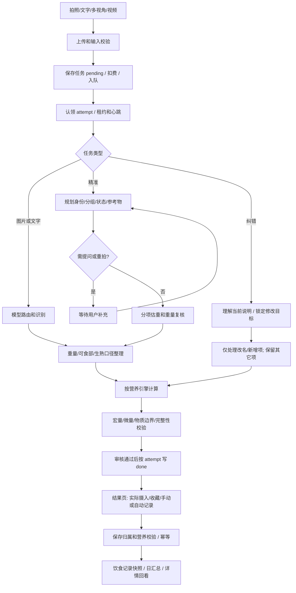

# 食物识别全链路审计、修正与监测说明

日期：2026-10-17，北京时间。范围：FoodLink 图片、文字、多图/多视角、视频关键帧、精准分项、营养计算、纠错、异步任务、记录保存与回看。

交接更新：用户已取消继续修改，要求保存现有工作。算法代码存于本地WIP提交`f7fc7048`，食堂及录餐改动存于`0a16ed52`；本报告随文档交接提交。下述检查是审计期间已有证据，提交阶段没有新跑测试或构建；未推送或部署。已知失败、未修问题和未验证范围保持有效。

**结论：存在多处流程契约不一致。昨晚牛肉纠错是已经定位的真实事故，不是只能归咎于模型波动。此次没有把整套系统判为“已修好”。**

本报告分清四类证据：真实任务已证实、源码确定的可触发缺口、本次定向检查通过、尚未运行验证的风险。代码防线通过不等于食物身份或营养值经实测准确。

清单共21项：9项已有本地修正，1项仅封堵归属部分，11项尚未修正；这不是缺陷总数上限，也不是全部模式运行验收结论。监测新增埋点及11面板/3告警候选已准备，尚未启用线上。

## 1. 昨晚为什么会忽略用户原话

真实任务与截图的羊肉锅1500g/950kcal、辣子鸡350g/880kcal、米饭180g/234kcal逐项吻合。

| 北京时间 | 输入及真实任务 | 实际输出 |
|---|---|---|
| 10月16日19:12:08 | 初次识别 `c7d768a4…` | 羊肉锅、辣子鸡、米饭 |
| 19:12:54 | 纠错 `990063b4…`：**这个是翘脚牛肉** | 三项名称、重量、四大营养原样返回；`done`、`correctionApplied=true` |
| 19:16:34 | 再纠错 `8dd2de31…`：**这是牛肉啊** | 仍原样返回；再次标记纠错成功 |
| 19:18:47 | 另一条首次识别 `3eb07477…`，补充“牛肉”，未带纠错链 | 清汤牛肉火锅2200g、辣子鸡420g、米饭200g；不是前两条纠错成功的证据 |

发生的顺序是：

1. 前端把用户原话放进 `additionalContext`，并附上当时的完整食物清单。
2. 因为用户是在补充说明中说“牛肉”，没有直接改清单的名称输入框，清单仍是“羊肉锅”，`nameEdited=false`。
3. 后端为了保留未修改食物，提前进入定向合并分支，绕过正常的完整模型识别。
4. 该分支只用两个正则理解改名：必须说出**完整原名**，例如“不是羊肉锅，是牛肉锅”或“把羊肉锅改成牛肉锅”。“这个是翘脚牛肉”“这是牛肉啊”均不匹配；连“不是羊肉，是牛肉”也不匹配完整旧名“羊肉锅”。
5. 系统把所有食物判断为未改，复制旧结果；最后没有检查实际修改是否发生，就标记成功。

**这是实现把用户说明当成了可忽略的辅助文字，再用状态成功掩盖了语义未执行。修复和验收此前没有覆盖正常口语纠错，是明确的工程缺陷。**

最初为什么出现“羊肉”也要分清证据：原任务是`standard + ai_direct`，无补充说明，三项`nutrition_source=ai_direct`、`matched_food_id=null`；`basisEvidence`直接写了“羊肉片及蔬菜”。可确认是模型直接识别阶段已经认错，并非营养库把牛肉名称替换成羊肉。现存摘要不能证明视觉上究竟依据了哪处纹理，也不能把模型自己写的“羊肉片”当成独立事实。结构/数值门禁不判断牛羊真值，因此该错误能进入结果页；用户明确纠正原本应是下一道有效约束，却又被旧纠错分支忽略。

前端入口在 `apps/wechat/src/packageExtra/pages/result/index.tsx`，结构化清单在 `correction-payload.ts`；后端入口为 `worker.completeCorrectionTask`、`resolveScopedCorrection`。不能让用户学习特定句式来迁就这段实现。

这也不同于10月15日“缺少calories”的事故：上次是查库前误要求模型营养；昨晚是任务成功但根本没落实改名。10月17日本次实查线上已经是后续版本，不能继续沿用上次“修正未部署”的旧结论解释昨晚。

## 2. 当前线上和本地的边界

- 10月17日本次只读实查：main generation179、dev generation216，各3个Ready；镜像分别以 `b3c1bc58…`、`da3a609d…` 开头，与10月15日发布记录对应。
- 两套配置的链路追踪和指标均开启，指标导出间隔5秒；两套任务队列均为 Kafka。
- 本次所有修正仍在本地 `dev`，已按用户要求保存WIP提交，**未推送、未同步main、未构建镜像、未部署、未上传小程序**。没有线上迁移或业务数据修写。
- 其他对话的食堂上传、地点、布局和迁移改动保留，不属于本报告的发布候选。

## 3. 不是一个模型，而是两条控制轴和多种入口

“识别模式”控制模型、图片协议、推理/等待和是否先规划；“营养引擎”控制营养从哪里来。二者不能混为一谈。

| 轴 | 主要值 | 影响 |
|---|---|---|
| 输入 | 图片、文字、多图、多视角、视频关键帧、手动/食物库 | 输入证据、去重和份量依据不同 |
| 模式 | 快速、普通、精准、精准分项、联网及历史兼容值 | 模型路由、采集要求、规划/提问、超时和回退不同 |
| 营养引擎 | `ai_direct`、`ai_then_db_exact`、`db_candidates_ai` | 模型直估、精确校准、候选复核 |
| 兼容分支 | `db_first`、`legacy_direct` | 旧接口、纠错及内部处理仍使用 |
| 修改方式 | 单项编辑、底部自由纠错、整餐清单、已保存记录编辑 | 是否重算、修改哪个对象、是否新建任务不同 |

主要实现入口：

- `apps/wechat/src/utils/analysis-engine.ts`
- `backend/internal/analyze/service/analysis_engine.go`
- `backend/internal/analyze/service/analyze_service.go`
- `backend/internal/analyze/service/vision_balanced.go`、`vision_channels.go`
- `backend/internal/worker/worker.go`

实际矩阵是这些维度的组合，不是“测了快速/普通/精准三个按钮就全部通过”。

## 4. 全链路流程



任一环节“调用成功”，都不能替代下一环节的业务约束。JSON能解析、任务写done、记录保存成功、实际识别正确，是四件不同的事。

## 5. 每一环做什么，在哪些地方会出错

| 环节 | 当前实际处理 | 关键约束与风险 |
|---|---|---|
| 图片选择 | 普通最多5图，压缩尺寸/体积；严格模式要求指定角度 | 模糊、遮挡、拍到同菜多次仍可能漏识别或重复算；多角度去重主要靠模型 |
| 上传 | 对象存储引用；条件满足时可用旧上传路径 | 上传成功不保证模型渠道能下载；CDN、TLS、URL过期是独立故障 |
| 视频 | 2–12秒、8MB；按4FPS取候选，中间分窗选清晰帧，最多5帧 | 模型看的是关键帧，不是完整视频/音频；只在间隙或首尾出现的菜可能遗漏。本轮未做视频回放 |
| 输入边界 | 检查图数、采集协议、参考物、日期、额度 | 角度和参考物是否真的符合声明，仍需模型及用户证据 |
| 任务创建 | 新UUID、pending、积分分组、发布队列 | 缺请求幂等；提交超时后再点可能新建另一任务；记录幂等不能代替提交幂等 |
| 消费认领 | 行锁、新attempt、租约、心跳 | 能防同一投递重复执行、旧attempt覆盖；不能防用户发起两个不同任务 |
| 模型路由 | 快速图片偏千问；普通/精准图片按配置选择Gemini渠道；文字有独立模型路径 | 同名模式不代表同一模型；新任务key可能改变渠道。模型与渠道均应被记录 |
| 渠道回退 | balanced最多三渠道串行，首个满足结构门槛即接受；另留有旧hedge/shadow | 不是多模型投票。模型自信地认错牛羊，仍可通过结构检查 |
| JSON解析 | 图片多为JSON模式；部分文字使用严格Schema；有业务字段校验 | JSON合法不等于语义正确；缺字段不能先补0再把0当模型原值 |
| 精准规划 | 识别身份、状态、问题、参考物和分组；可等待提问/重拍 | 不交互时可能按最可能答案继续，是接受不确定性；不是确定事实 |
| 精准续答 | 把本轮补充叠入会话输入 | 本轮本地改为只合并实际提交字段；线上尚未更新，微信续答/跨零点运行证据未补 |
| 分项估计 | 每组/每项估重，之后可重量复核 | 本轮补了身份及完整性门禁；不允许计划牛肉却收羊肉，或漏一项仍成功 |
| 重量处理 | 毛重、可食比例、净重、生熟/干湿口径；部分计数物校准 | 重量改变后，原营养究竟对应哪个重量尚未完全统一，存在密度被动改变的风险 |
| 营养库 | 标签、包装、普通精确、候选、模型估算等分支 | 同名不能代表同状态、同皮骨、同配方；库来源质量与营养准确性不能画等号 |
| 模型营养兜底 | 多估算器并发，逐项收集先返回的有效结果 | 本轮补了“有效结果”定义；过去非空行就可能抢赢并取消真正有效的慢结果 |
| 微量营养 | 复用完整字段或估算后缩放 | 本轮补字段数值校验；字段完整不等于每字段都准确，未知与真实0尚未完全区分 |
| 建议比例 | 根据目标与剩余热量提出建议比例 | 建议比例不是实际吃了多少；未采纳的建议不能计入摄入 |
| 自由纠错 | 本轮新增口语→受限修改计划→目标营养重算→合并 | 指代不清需明确说明；不得忽略说明、不得改其它菜；仍不是任意复杂配方编辑器 |
| 完成与审核 | 营养有效且审核满足条件后写终态；审核等待可保存中间结果 | 审核、模型、网络、身份和营养门禁必须分开统计；审核回调应复用结果而非再调AI |
| 展示/编辑 | 前端保存当前快照及任务上下文 | 全局缓存与旧页面task ID存在错配风险；“显示已修改”不等于保存请求已成功 |
| 记录保存 | 核验归属、任务完成态、营养，按source task防重复 | 本轮补了来源归属；纠错新任务与原餐记录如何更新仍有缺口 |
| 自动记录 | 仅明确开启且无待确认条件时执行；与手动共用保存路径 | 任务done与自动记录成功分开；自动保存失败不能冒称已记录 |
| 历史补全 | 旧记录缺信息时从来源任务补图/营养/点评 | 本轮封堵跨账号来源；同账号的可变任务/位置回退仍可能污染历史快照 |
| 失败/退款 | 按attempt失败；按来源键幂等退款 | 退款失败尚缺持久补偿队列；不能承诺每次立即可靠退回 |

## 6. 必须讲清楚的数字和数据依据

### 6.1 五个不同的量

1. **毛重**：当前普通图片合同指食物含骨、壳、核等的重量，不含袋子、包装和容器；汤是否纳入须另有依据。不能把秤上容器总重直接作为食物毛重。
2. **可食比例**：从毛重换成可食净重。骨/壳不吃，与用户只吃一半不是同一件事。
3. **当前可食重量**：营养计算基准，还须说明是生重、熟重、干重、泡发后还是上桌状态。
4. **建议摄入比例**：系统建议，尚不是实际摄入。
5. **实际摄入比例**：用户确认实际吃掉的比例，日摄入只算这部分。

按当前实现的基本换算：

```text
可食净重 = 毛重 × 可食比例
整份营养 = 每100g营养 × 可食净重 / 100
实际摄入营养 = 整份营养 × 实际摄入比例
```

纯算术例：假设某食物毛重500g、可食比例70%，则净重350g。假设每100g为100kcal，则整份350kcal；实际吃60%才记210kcal。不能先把净重乘60%，再把营养乘两次60%。

截图中的1500g是模型对整锅的估计，不等于测得1500g纯肉。汤、肉、菜分别多少、用户喝了多少汤，是另一层事实；名字改成牛肉也不能证明这个重量估计正确。

### 6.2 生熟、干湿、皮骨与配料不能靠一个名字概括

- 同名米粉可能是干粉、泡发后或熟制；同名鸭腿可能带皮带骨或去皮净肉。
- 水分变化会改变每100g密度，不凭空增加蛋白或脂肪；加油、糖、奶、酱料会改变营养组成。
- 当前已有状态/口径/皮骨/部分烹调方式的复用拒绝规则，但词表与模型语义都有限，不是完整的物料守恒求解器。
- 已有“整批只有5g油”等提示词约束，尚没有程序级配料账本证明每项油脂、吸水率和分摊都闭合。

### 6.3 营养引擎的实际差异

| 引擎 | 主要流程 | 已有保护 | 尚未解决的重点 |
|---|---|---|---|
| `ai_direct` / `legacy_direct` | 模型直接给本餐上下文营养；图片标签可优先 | 基础有效值、明确重量、最终保存门禁 | 视觉/份量/隐形油料仍可能错；结果展示和保存的能量校准不完全一致 |
| `ai_then_db_exact` | 先估算，再用允许的精确库校准单一食物 | 有混合配方/额外配料保护 | 精确名称仍须满足状态和来源条件 |
| `db_candidates_ai` | 先估算，最多5个兼容候选交AI判断是否直接复用 | 四个等价条件均真且自报confidence≥0.97，程序硬冲突仍拒绝 | 0.97是模型自报，不是经统计校准的准确率；候选召回不保证穷尽 |
| `db_first` | 标签→包装库→普通精确→候选复核→模型补全 | 状态、口径、皮骨、未审历史均值等门禁；本轮补齐已标明配方的自动复用保护 | 是否正确识别并标明额外配料仍依赖上游；没有配料守恒账本 |

库中的人工整理、历史均值、模型估算、包装标签和AI补微量不是同一种证据。当前有来源字段，但每个营养字段的来源/未知状态还未完整贯穿保存与回看。

### 6.4 宏量、微量和能量

- 当前主要用 `calories = protein×4 + carbs×4 + fat×9` 进行AI能量闭合。这是代码采用的简化计算规则；可信标签的独立能量值、膳食纤维/糖醇/酒精等还需要一致策略。
- 本轮增加 `P+C+F ≤ 可食重量 + max(0.1g,2%净重)` 的物质边界，拒绝100g食物却有130g或300g宏量的明显错误。容差用于舍入，不代表营养准确度。
- 微量“完整”目前表示字段存在、数值有限非负及最低正值条件，不等于实验测定。缺失默认0、真实0、模型估计0仍缺统一状态模型。
- 包装专用路径有每份/每100g/每100ml和kJ÷4.184换算；普通图片标签采纳的严格程度不同。
- ml不能普遍当作g。按每100ml计算液体总量可能正确，但把同一数值对外写成称重克数会误导后续密度计算。

## 7. 已确认问题和本轮实际处理

以下本地修正都未部署。“已修”仅表示实现及所列定向检查，不表示已覆盖全部业务组合。

| 编号 | 问题/具体触发 | 影响 | 本轮状态 |
|---|---|---|---|
| F01 | 正常口语未匹配完整旧名，清单未改却标纠错成功 | 用户纠错被静默忽略 | **已本地修正**：受限语义计划＋无变化拒绝；两句真实原话模型回放通过 |
| F02 | 精准单项/分组允许无匹配、按位置关联或漏项子集 | 牛肉计划接收羊肉；漏菜仍done | **已本地修正**：逐项唯一身份及完整性契约、提示词同步、复核失败保留原完整结果 |
| F03 | 并发兜底只看非空行，或补零后掩盖原始缺字段 | 无效快结果抢赢，取消有效慢模型 | **已本地修正**：补零前检查四基础字段；抢赢前有效值门禁 |
| F04 | 100g食物允许P60+C60+F10或P100+C100+F100 | 不可能的组成；显示/保存能量跳变 | **已本地修正**：共享物质边界拒绝，不静默改数 |
| F05 | 微量字段存在即可通过，部分字段可为字符串、负数等 | 格式错误仍被标微量完成 | **已本地修正**：逐字段数值有限、非负检查 |
| F06 | 保存及补图/营养未统一校验source task归属 | 潜在跨账号关联读取 | **已本地封堵**：保存、幂等返回前及历史补全均校验本人来源；未在线利用或批量查用户隐私 |
| F07 | 队列发布回执丢失后，producer把processing/done覆盖failed | 算完仍失败、无法回写、错误退款 | **已本地封堵**：明确拒绝才pending CAS；未知回执保留同一任务，不降级已认领/完成状态 |
| F08 | `db_first`同名精确库未检查混合配方 | 已标明白饭＋5g油仍可能套普通白饭值 | **已本地修正**：复用既有配方约束，同时阻止普通精确/词法/向量/候选AI绕回；不等于上游识别配料总正确 |
| F09 | 精准续答按完整新建的默认值覆盖会话 | 丢牛肉/去皮说明，跨零点变日期，切营养引擎 | **已本地修正**：按实际提交字段局部合并；说明追加、答案按问题ID合并、显式false保留；尚无微信/跨零点运行证据 |
| F10 | 三渠道合法135秒，聚合仅等120秒，另有排队/复核/营养耗时 | 子项仍运行，汇总先超时 | **未修**；须统一端到端预算，不能只无限加timeout |
| F11 | Kafka恢复须租约过期且30分钟cooldown，5分钟扫描 | 崩溃任务可能等30—35分钟；processing不能主动重试 | **未修**；本次已确认两套线上均Kafka |
| F12 | 提交/用户重试没有请求幂等键 | 客户端超时再点，生成新UUID、重复计算/扣费 | **未修**；新入队保护不等于提交幂等 |
| F13 | 已记录A再纠错成B，保存唯一性只按不同task ID | 可能新建第二条摄入；A仍旧值 | **未修**；需定义和实现原餐更新/版本冲突，不能静默新建 |
| F14 | 旧页面A使用全局缓存B的task ID；编辑异步全量覆盖无版本 | 写错来源或后到旧请求覆盖新请求 | **未修**；需页面固定身份、版本条件和失败可见性 |
| F15 | 历史补全把0当缺失，名称不匹配还能按数组位置，且不统一按记录重量缩放 | 历史数值可能随可变任务改变 | **部分封堵**：归属已修；不可变快照、缺失标记与份量仍未修 |
| F16 | 零能量名字规则不一致 | 合法品牌水可能被拒绝 | **未修且保留失败回执**；不靠不断补商品名掩盖 |
| F17 | 改净重/可食比例后没有统一重定基原营养 | 份量、密度、总营养可能互不一致 | **未修**；需单一数值来源与重算约束 |
| F18 | 分析页只在大偏差时修能量，保存AI来源再严格4/4/9 | 用户记录后热量变化 | **未修**；需统一展示与保存规则，兼容可信标签 |
| F19 | 精准确认页固定图片source type | 文本精准会话续答可400 | **未修**；源码有路径证据，未小程序运行复现 |
| F20 | 无有效规划仍可能回落“整餐” | 规划缺失被统计成成功 | **未修**；需区分合理整餐与无效规划 |
| F21 | 退款失败只有日志/后续读取触发，缺持久补偿任务 | 部分失败退款可能长期未补 | **未修**；不承诺全部即时退款 |

还有无法靠程序格式门槛消除的认识边界：隐藏油料、相似肉类、照片尺度、实际食用份量、菜谱差异，以及真实营养库覆盖率。这些必须通过不确定性表达、用户确认和有真值的样本验证管理，不能虚构一个“算法准确率”。

## 8. 本轮纠错修正到底保证了什么

实现位于 `service/correction_instructions.go`、`worker.completeCorrectionTask`、`worker/scoped_correction.go`。

1. 原话和当前清单进入独立的意图理解步骤，不发原图、不发送旧营养来诱导重估整餐。
2. 输出仅允许现有清单索引及受限字段：名称、用户明确克数、用户明确热量。索引越界、重复、额外字段、空名、无效数值拒绝。
3. 清单里直接编辑过的名称、重量和营养优先；模型不能改回旧值。
4. 名称纠错不能夹带未声明克数；数值还必须对应目标菜，不能把“米饭200克”套到牛肉锅。
5. 旧文字上下文和完整多行原文分离，不能把上轮说明/原文数字当成本轮指令。
6. 改名/新增项才进入营养计算；其它项保留原重量、营养、来源及摄入信息。
7. 完全无实际名称、重量或营养变化，拒绝标记纠错成功。
8. 对能唯一绑定到菜的明确重量/热量反向检查，拒绝只改菜名却遗漏另一项数值；名称中夹带未请求克数/热量也拒绝。明确手填的完整营养快照锁优先，单纯旧快照不当成显式改数。

数值绑定包含菜名和分句启发式，并非完整自然语言证明。简单否定/旧值已有回归，复杂指代、引用、分摊、一般名称语义或模型漏掉不含数值的要求，仍可能误解；当前不能承诺任意说明都被程序逐句证明落实。新解析模型不可用时会明确失败，不应吞掉自由说明继续报成功。旧固定句式改名函数已从运行代码移除。

本次实际模型回放结果：

| 输入 | 实际计划结果 | 其它重量 |
|---|---|---|
| 这个是翘脚牛肉 | 羊肉锅→翘脚牛肉 | 保留1500/350/180g |
| 这是牛肉啊 | 羊肉锅→牛肉锅 | 保留1500/350/180g |
| 有羊肉锅和羊肉串时说“这个是牛肉” | 要求明确目标，不猜一项 | 不应用修改 |

首轮真实回放曾对完整菜名过于保守而要求澄清；已依据该失败调整通用的“唯一同类菜形态”提示，第二轮上述三例符合预期。没有抹掉首次失败证据。

**能力边界：** 当前受限计划不是任意自然语言编辑器。“整只去骨”“整批调料分摊”“含汤但没喝”等还需要扩展有依据的字段和规则。不能假装这些说明也已全部支持。遇到不支持的说明应明确失败/要求补充，而不是返回旧值报成功。

## 9. 哪些防护有证据，可以保留

这些不是“保证永远没bug”，而是已读到对应实现或本次有定向检查：

- 任务查询、结果修改、重试已有当前用户归属检查；本轮补齐保存和历史关联出口。
- 行锁认领、attempt隔离和心跳能阻止旧执行结果随意写回新attempt。
- 纠错默认不自动记录；自动与手动共用保存唯一性。
- 营养库状态、重量口径、皮骨等明确冲突不能被模型自报高confidence覆盖。
- 普通fuzzy top1不会直接提升成可信精确结果；模型别名进入待审，不直接永久自动别名。
- 运行时本餐估算不应覆盖人工整理库或写成通用同名食品。
- 包装弱模糊候选不自动定规格；用户明确重量优先；规格歧义存在等待确认。
- 本轮校验了纠错未改项保持、精准完整性/身份、并发无效赢家、宏量物质边界、微量字段、保存归属和入队状态竞态。

## 10. “所有环节监测”应该如何理解

监测至少要分三层：

1. **运行层**：上传/队列/模型/数据库/审核可用性、耗时、重试、租约、异常。
2. **约束层**：明确名称/重量是否落实、计划与返回是否一一对应、状态口径是否冲突、营养是否完整、未改项是否保持、保存前后是否一致。
3. **质量层**：与用户纠正、称重、包装标签、可信真值样本比较，测身份、份量和营养误差。前两层全绿不能替代第三层。

### 10.1 本次线上观测底座实查

- 主/开发两套OTel trace和metrics都开启；Collector、Jaeger、Prometheus、Grafana有运行且Ready的实例。
- 实际Prometheus指标有 **`otel_` 前缀**，例如 `otel_food_link_food_analysis_total`。服务环境区分标签为 `exported_job=food_link-backend-main/dev`，不是想当然的环境标签。
- Collector的trace流向Jaeger，metrics流向Prometheus。
- **logs exporter仅为debug**。这不等于已经拥有长期、可检索的业务日志库。K8s/stdout留存与完整脱敏回放链路未在本轮建立。
- 本次只读窗口10月16日至查询时，13条已完成纠错中有5条名称、重量及四大营养完全相同的**候选**；其中两条是已核实牛肉事故。其余未逐条判断意图，不能宣称5条全是失败或把它算作准确率。

### 10.2 环节观测矩阵

| 环节 | 当前能看见 | 必须继续补/保留的事实 |
|---|---|---|
| 提交/上传 | HTTP、上传和数据库日志 | 客户端请求键、图片处理前后字节数、明确输入约束版本 |
| 入队/认领 | 投递/认领结果、attempt、租约、心跳、队列指标 | 确定拒绝与ACK不确定分开；待恢复年龄/退款补偿可观测 |
| 模型路由 | provider/model/upstream、阶段耗时、渠道结果 | 每任务有效配置/提示词/Schema版本指纹；不能只依赖服务当前配置 |
| 原始解析 | 语法失败、部分文字字段形态摘要 | 缺失、类型错、语义错、数值无效分开；不保存完整敏感响应 |
| 精准规划 | 会话、分组和子任务、提问/重拍 | 规划项数、实际唯一匹配数、漏/重/身份冲突专门原因码 |
| 重量/可食部 | 部分前后值和来源/假设 | 每次重量变化是否重定基营养；毛重、净重、汤和实际摄入分开 |
| 库检索/复用 | 候选ID、来源、命中/拒绝、状态原因 | 配方等价、库版本/质量状态、被截断候选数 |
| 兜底/微量 | 模型耗时、来源、部分完成/缺字段 | 每项赢家、拒绝无效快结果原因、微量未知/实零/估计状态 |
| 纠错 | **本轮新增**指令解析span、解析结果计数、无变化门禁 | 本轮说明是否全部落实；后续扩字段时继续受限，不退回整餐重估 |
| 完成 | 任务终态、有效营养门禁 | **本轮新增**前后项数/变化数/来源/缺状态摘要；done不等于准确 |
| 保存/回看 | 记录ID、来源任务、保存/自动记录日志 | 不可变快照、版本冲突、服务器总量与客户端差异、是否替换原餐 |
| 失败/退款 | 错误、幂等退款流水 | 退款未完成的持久待办及补偿次数，不能只打一条Warn |

### 10.3 本轮已准备的监测实现

- `backend/pkg/metrics/algorithm.go`：低基数门禁/结果条目计数，不把用户ID、任务ID、菜名或原话当指标标签。
- `backend/internal/worker/algorithm_audit.go`：仅在本attempt终态持久化后记录执行摘要，包含任务/attempt、模式/引擎、前后项数、实际变化数、未解析/缺重量/缺状态数、营养来源类别。
- `analysis.correction.instructions` span：把口语解析与营养重算区分；不再只见“请求成功”。
- `food_link_algorithm_gates`：区分纠错解析/实际变化、精准身份/复核、营养兜底、微量字段、最终营养与任务终态。统计校验次数，同一profile的复用与最终检查可能各计一次；没有模式上下文的分支为`other`，不编造环境/引擎。
- `food_link_algorithm_result_items`：按最终任务/子任务角色区分总条目及缺信息条件。不能把精准子任务和汇总重复算成用户餐数。
- 看板候选：`docs/monitoring/recognition-algorithm-dashboard.json`；分别展示通用LLM封装和主视觉渠道的调用/耗时，以及阶段、营养、新门禁/状态缺失指标。两套调用计数不能直接相加：balanced主视觉不走通用LLM计数，旧hedge又可能同时记两套。
- 告警候选：`docs/monitoring/recognition-algorithm-alerts.yml`，纠错未落实、15分钟内多次营养门禁拒绝、处理失败突增。阈值是待校准的运维策略，不是准确率标准。

本轮逐条把11个面板和3个告警表达式送往实际Prometheus做只读瞬时查询：语法/执行均成功，7个旧指标面板当时有3—13个结果序列，4个新指标面板没有序列，符合尚未部署。JSON/YAML结构已解析；未用`promtool`做规则加载兼容检查。回执为 `monitoring-validation.json`，这不是Grafana渲染或通知送达验收。

**看板和告警尚未导入线上，新增埋点尚未部署，不能称“全流程实时监测已启用”。** 本轮没有改共享Collector、Grafana、Prometheus或通知配置。新指标无数据时，不应显示为“0问题”。

## 11. 新修正会不会带来新bug

会有兼容风险，必须明列，不能因为测试通过而否认：

| 修正 | 可能的新表现 | 本轮控制和剩余边界 |
|---|---|---|
| 自由纠错理解 | 多一次模型依赖/约1秒级实测耗时；含糊句子要求明确 | 25秒总预算、最多一次格式修复；直接清单编辑不新增模型依赖；本次样例不代表所有语句 |
| 数值目标绑定 | “两道菜各200g”等省略表达可能被保守拒绝 | 不猜目标、不改变其它菜；复杂数量表达应扩专门契约和回归 |
| 无变化拒绝 | 单纯确认原值也可能被要求填写有效修改 | 明确提示未应用修改，不再伪称成功；可后续单独设计“确认原结果”动作 |
| 精准身份完整性 | 罕见真别名或无ID的同名两份食物可能从接受变为失败 | 仅接受明确别名/状态兼容；同key也不能掩盖身份冲突；需固定样本治理别名 |
| 更严格营养门禁 | 旧不合理营养再次保存时会拒绝；部分模型调用失败率可能上升 | 拒绝假数据，不静默改历史；分开看“拦住坏值”和“模型更差” |
| 来源任务归属/完成态 | 历史客户端传不存在/未完成task ID会被拒绝 | 手动无source保存保持；本人已完成任务/幂等用例覆盖；不伪造完成态 |
| 配方自动复用保护 | 额外配料项更多进入模型估算，可能更慢或失败 | 纯食物仍能命中；估算失败不能偷偷回套基础食物；上游漏标配方仍有风险 |
| 精准续答局部更新 | 明确空说明/false的语义与原来不同；旧内部DTO不能表达未记录presence的false | HTTP保留字段存在信息；旧DTO按非零推断兼容；完整继承证据重新审核，实际运行仍待验收 |
| 未知队列回执保留pending | 不会假失败，但可能暴露原有很慢的恢复机制 | 只用同task ID、不重复扣费；30—35分钟恢复缺口仍存在 |
| 新日志/指标 | 增加少量采集开销和存储；标签设计错误会膨胀 | 指标标签白名单，日志只有摘要；未记录原图、Base64、提示词、凭证或完整原文 |

本轮没有做大范围删除分支、切换默认模型、全库覆写或历史数据修正。后续清理应先把各入口统一到有版本的约束契约，再逐步移除死分支；不能一边改提示词一边继续叠不同语义的默认值。

## 12. 实际验证、已知失败和未验证范围

### 12.1 本轮实际通过

- 两句真实口语和一条歧义场景的直接模型回放，无真实任务创建、用户积分或业务库写入。
- 纠错计划边界：越界、重复、空名、未知字段、直接编辑锁、无明确克数不得改重量、数字不得套错菜、多行旧原文剥离、热量单位。
- 定向合并：只重算目标，另两菜重量和营养保持；无变化拒绝。
- 精准计划/返回完整性、身份、生熟口径、metadata与提示契约的定向回归。
- 精准续答的遗漏字段保留、跨日期默认值防覆盖、说明/答案合并、嵌套显式false及handler字段存在信息；未做真实跨零点会话。
- 已标明混合配方的普通精确/候选绕回拒绝、同餐纯白饭仍精确命中，估算失败保持失败而不套无油库值。
- 兜底原始字段、无效快结果/有效慢结果竞态、物质边界、微量类型/有限性。
- 真实临时PG：保存自有/他人/不存在/非完成/违规任务、幂等、手动无来源、历史脏关联详情与列表。
- 真实临时PG＋模拟发布器：图片/文字各9分支及原回归，覆盖ACK不确定时仍pending、已认领、已完成，以及明确拒绝和取消。
- 格式检查、相关包编译和本轮指定检查。没有运行本地全量测试/全量构建/压测。

证据分别在以下任务目录：

```text
D:/cache/agent-tests/beef-correction-20261017/
D:/cache/agent-tests/algorithm-audit-nutrition-20261017/
D:/cache/agent-tests/algorithm-audit-precision-20261017/
D:/cache/agent-tests/algorithm-audit-ownership-20261017/
D:/cache/agent-tests/algorithm-audit-enqueue-20261017/
```

### 12.2 保留的一条明确失败

`TestChainedNutritionFallbackEstimatorAcceptsBrandedPlainDrinkingWater` 原正向断言没有删改，独立执行仍失败：完成2/3项。它暴露了合法品牌水与共同零能量名单不一致。不能用换成“白水”的测试名称、放宽错误值校验或删除断言把它变绿。

零能量饮品也需要专门核对“微量至少4项正值”的既有规则是否适用，例如纯净水不能靠编造矿物质去通过完整性门槛；这部分没有在本轮建立新的饮品分类契约。

因此不能宣布“所有相关测试全绿”。本轮新增防线专项通过，与这条残留兼容问题分开交付。

### 12.3 没有做、因此不能声称通过

- 全部模式×引擎×输入×纠错×记录状态的完整矩阵。
- 带真实图片和称重真值的身份/份量/营养准确率评估。
- 视频固定样例回放、新候选的完整微信UI及真机验收。
- Kafka真实断网/崩溃/长时间压测，第三方模型长周期稳定性。
- 已保存餐纠错更新、旧页面缓存错配、多次编辑乱序、跨零点精准续答的运行验证。
- 新后端部署、看板导入、告警触发及通知送达。

## 13. 后续清洗顺序和交付门槛

1. 先完成剩余确定性约束问题：品牌水零值依据、展示与保存同一套营养计算，并给已本地修正的精准续答与`db_first`配方保护补实际用户路径证据。
2. 再处理任务与记录身份：请求幂等、已记录餐纠错只更新原餐且有版本冲突检查、固定页面task ID、不可变快照。
3. 统一端到端预算、崩溃恢复、待审核/待恢复/待确认状态与退款补偿。
4. 统一有版本的输入约束/结果契约/营养来源；移除只剩测试引用或已不可达的旧模糊分支，避免以后又接回错误路径。
5. 用固定回放矩阵验证输入、每段中间结果和保存结果，覆盖失败恢复；再做有限的真实模型/微信路径，不以一张图或一个HTTP200结案。
6. 最后建立真值样本，分别量身份、份量、能量和营养误差；“库命中率”“模型同意率”“JSON通过率”都不能替代准确率。

发布、共享监测配置变更和任何真实历史记录修复必须有对应授权。即使用户授权发布，也应先明确未修高风险、品牌水已知失败和回滚方式，不能把其它对话的迁移/未提交修改一起夹带上线。

## 14. 空间与资源

只有定向检查、代码和小型文档/JSON，没有下载媒体、模型或创建镜像。测试TEMP/TMP/TMPDIR/GOTMPDIR/FOODLINK_TEST_TMPDIR限各自D盘任务目录，复用已有D盘Go缓存，未修改全局临时目录。

临时PG均已停止；ownership/enqueue两组保留临时产物合计298,704,916字节，约285MiB，其他任务主要为小日志/JSON。共享Go缓存增量未单独量化，不能把全部共享目录当成本任务新增量。

末次空间清点：六个本任务D盘测试目录共298,852,735字节（约285MiB，清点后新增清单本身不含在内），跳过两处共享bin Junction；另有小型代码/文档，没有大媒体。详细回执`beef-correction-20261017/space-summary.json`。

对三处本任务PG目录的精确清理被自动审批以 `blocked by policy` 拒绝，没有换工具绕过。交接后可手动仅清：

```text
D:/cache/agent-tests/algorithm-audit-ownership-20261017/embedded-postgres-go/pg-38908-30361
D:/cache/agent-tests/algorithm-audit-ownership-20261017/embedded-postgres-go/pg-39908-60114
D:/cache/agent-tests/algorithm-audit-enqueue-20261017/embedded-postgres-go/pg-36620-52318
```

保留检查日志即可。目录内bin含共享二进制Junction，不应沿链接删除共享目录；不要清理其它任务、用户库或仍在运行的服务。

## 15. 核心源码与证据导航

| 内容 | 实现/检查入口 |
|---|---|
| 图片/文字提交、积分、会话、任务 | `backend/internal/analyze/service/task_service.go`；`precision_continuation.go`；handler `ContinuePrecisionSession` |
| ACK不确定与pending条件更新 | `analyze/service/task_enqueue.go`；`analyze/repo/task_enqueue.go`；`task_enqueue_test.go` |
| 串行视觉渠道与调用门槛 | `analyze/service/vision_balanced.go`、`vision_channels.go` |
| 图文提示、解析、查库、微量 | `analyze/service/analyze_service.go`；`ordinary_photo.go`；`text_nutrition_validation.go` |
| 引擎分流、精确/候选复用约束 | `analyze/service/analysis_engine*.go`；`db_first_recipe_contract_test.go` |
| 每100g模型兜底及竞态 | `analyze/service/nutrition_fallback.go`、`deepseek_nutrition.go`、`nutrition_fallback_validation_test.go` |
| 口语计划、历史剥离、字段锁、数值覆盖 | `analyze/service/correction_instructions.go` 及同名测试；`worker/correction_instructions_test.go` |
| 定向改餐和未改项保留 | `worker/scoped_correction.go`；`worker.completeCorrectionTask` |
| 精准规划、估计、复核、汇总 | `worker/worker.go`；`precision_item_contract.go` 及测试 |
| 共有营养/物质边界与零能量 | `foodrecord/domain/nutrition_validation.go` 及测试 |
| 保存、来源归属、历史补全 | `foodrecord/service/food_record_service.go`；`source_task_ownership_test.go`；`foodrecord/repo/analysis_task_repo.go` |
| 结果页身份、编辑、纠错和记录入口 | `apps/wechat/src/packageExtra/pages/result/index.tsx`；`correction-payload.ts`；`precision-confirm/index.tsx` |
| 新摘要与指标 | `worker/algorithm_audit.go` 及测试；`pkg/metrics/algorithm.go`；`docs/monitoring/README.md` |

表中后端短路径均相对 `backend/internal/`，`pkg/metrics`相对`backend/`。源码是当前本地审计依据，线上现状以第2节实查和后续实际发布核验为准。
